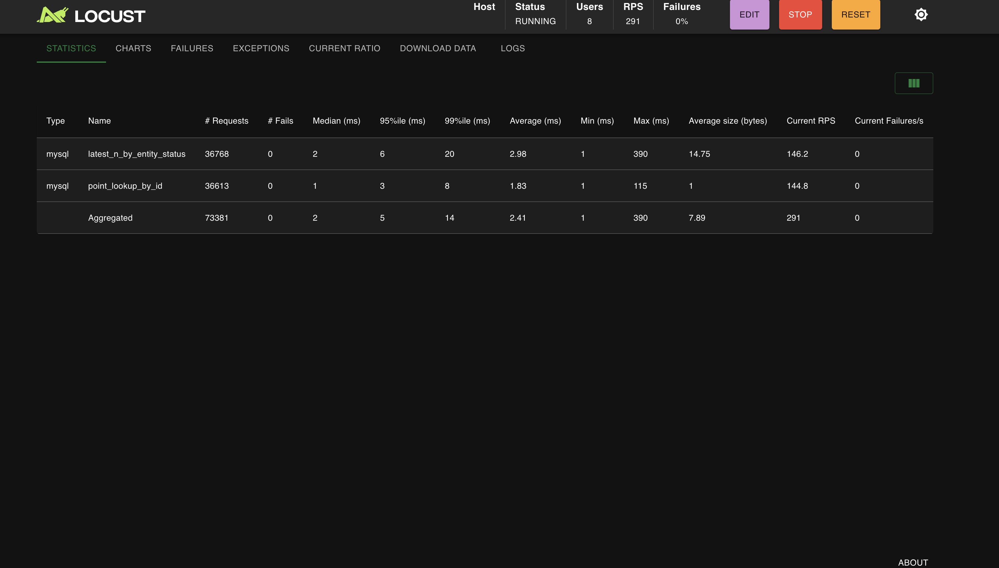
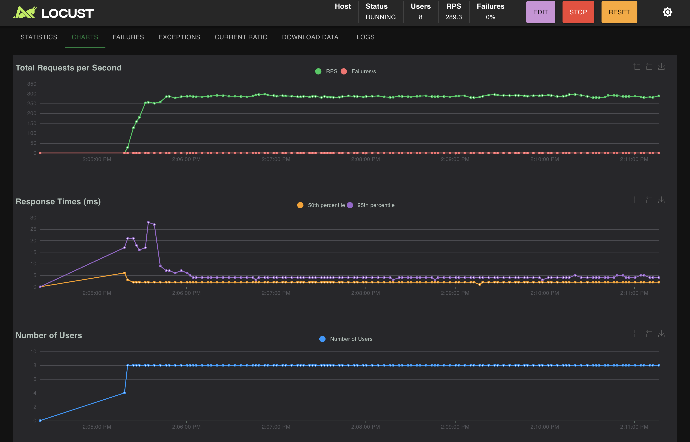

# EvidenceHub

A runnable reference platform demonstrating the full responsibility set of a Senior Data
Engineer job description: MySQL performance and sharding, ETL/warehouse pipelines,
high-volume updating data, and AWS/Redis/IAM operability. Built like a real platform, not a
tutorial: a deliberately bad legacy schema is migrated online to an optimized one, benchmarked
before/after, sharded across physical MySQL instances, streamed into a Kimball warehouse, and
wrapped in the security/observability posture a production system needs.

**Domain (swappable):** "evidence" records are facts about an entity/case collected from many
sources. Writes are append-heavy with frequent updates (status, confidence score, review state).

## Status

Building phase by phase (P0 → P8); see [PHASES](#phases) below. Current: **P0 Foundation**.
Every performance number in this repo is a real measurement, run on the hardware noted in
`docs/perf/`, or it isn't claimed at all.

## SLO targets (report actuals honestly — never invented)

| Query shape | Target |
|---|---|
| Point lookup by id | p95 < 50 ms |
| Latest-N for entity, filtered | p95 < 50 ms |
| Range aggregate | p95 < 300 ms |
| Batched ingest | ≥ 5,000 rows/s |

Targets assume ≥ 20M rows across 4 shards. Actual measured results live in `docs/perf/`.

## Baseline load test (legacy schema, P1)

Locust UI run against the legacy schema at ~21M rows, 8 users, ~5 minutes, limited to the two
critical queries fast enough to load-test (`BENCH_QUERY_NAMES=point_lookup_by_id,latest_n_by_entity_status`).
Both stay inside their 50 ms p95 SLO with 0 failures at ~290 RPS. The other 6 critical queries
take 16-132 s per execution on the legacy schema and are reported single-shot in
[`docs/perf/baseline.md`](docs/perf/baseline.md). The early p95 spike in the charts is cold-cache
warm-up. Numbers differ slightly from `baseline.md` (separate, longer run).




## Scale limit

Defaults are sized to run on a **16 GB laptop** (20M rows, 4 shards) and are parameterized to
scale up (`SEED_ROWS_FULL`, shard count). Day-to-day commands (`make up`, `make seed`,
`make demo`) use a fast ~1-2M row dev scale; `make seed-full` seeds the full 20M-row target used
only for the official benchmark reports in `docs/perf/`.

## Quickstart

```bash
cp .env.example .env     # or let `make up` do this for you
make up                  # start 4 MySQL shards + 1 catalog + Redis (core profile), wait healthy
make migrate-legacy      # apply the (deliberately bad) legacy schema to all 4 shards
make seed                # seed synthetic evidence data at dev scale
make check                # ruff + mypy --strict + pytest
```

Requires Docker, and [uv](https://docs.astral.sh/uv/) for Python 3.12 dependency management —
`uv` provisions the interpreter and virtualenv itself, no separate Python install needed.

## Repo layout

```
evidencehub/            Python package: api/ ingestion/ sharding/ cache/ common/
warehouse/{spark,dq}/   PySpark bronze/silver/gold Iceberg jobs, Great Expectations suites
airflow/dags/           Orchestration: reconciliation, DQ, compaction, backfill
db/{legacy,migrations,roles}/  Alembic migrations (legacy + optimized schemas), MySQL roles
queries/critical/       The 8-10 mission-critical queries, each tagged with its SLO
bench/                  Locust + EXPLAIN ANALYZE benchmark harness
infra/{terraform,docker,grafana}/  Terraform (plan/validate only), Compose, dashboards
tests/{unit,integration,chaos}/    pytest + hypothesis, testcontainers, failure-injection
docs/{adr,runbooks,perf}/          Architecture decisions, operational runbooks, perf reports
```

## Phases

| Phase | Scope | Gate |
|---|---|---|
| P0 Foundation | repo, tooling, core compose, CI, seed generator | `make up && make seed` works, CI green |
| P1 Baseline | legacy schema at scale, critical queries, baseline benchmark | before-report in `docs/perf/` |
| P2 Optimize | restructure, indexes, partitioning, online migration | before/after report |
| P3 Sharding | router, snowflake IDs, shard map, scatter-gather, resharding | reshard test, zero lost/dup writes |
| P4 Ingestion | Kafka, validator, DLQ, idempotency, reconciliation | |
| P5 Cache & API | Redis cache-aside, FastAPI, CDC invalidation | |
| P6 Warehouse | Debezium, Spark/Iceberg, star schema, GE, Airflow | |
| P7 Security | Terraform, IAM, MySQL roles, masking (validate-only) | |
| P8 Hardening | observability, load/chaos tests, CI perf gate, docs | |

MoSCoW if time is short: **Must** = P0-P3, P5. **Should** = P4, P6. **Could** = P7 depth, P8 chaos.

## Fixed stack

Python 3.12 (uv, ruff, mypy --strict, pytest, hypothesis, testcontainers), Pydantic v2,
SQLAlchemy 2 Core, Alembic, FastAPI · MySQL 8.0 (4 shards + 1 catalog) · Redis 7 · Kafka
(Redpanda) + Debezium CDC · Airflow 2.x · PySpark 3.5 + Iceberg on S3 · Great Expectations ·
Terraform → AWS (RDS/Aurora, ElastiCache, MSK, S3, Athena/Glue, IAM, KMS, Secrets Manager),
LocalStack locally · Docker Compose · GitHub Actions · Prometheus/Grafana · OpenTelemetry.

## Definition of done

Fresh clone → `make demo` seeds, ingests, shards, benchmarks, builds the warehouse, and prints
a before/after latency table. CI green. Every performance claim traceable to a file in
`docs/perf/`.
